# Monitoramento de Prateleira de Supermercado e Alerta de Ruptura com YOLOv8

**Atividade Avaliativa N3 - Tópicos Especiais (ADS / IFRO)**

**Aluno(a):** Henrique José Ferreira dos Santos **Data:** 16/11/2026

**Repositório (código, pesos `best.pt`, evidências):** https://github.com/heenrique288/monitoramento-prateleira-yolov8

**Notebook de treino no Google Colab:** https://colab.research.google.com/github/heenrique288/monitoramento-prateleira-yolov8/blob/main/treinamento/treino_yolov8_colab.ipynb
*(os pesos entregues em `modelo/best.pt` foram treinados localmente com o mesmo código e os mesmos parâmetros do notebook)*

---

## 1. Descrição do problema

**Ruptura de gôndola** é quando o produto não está na prateleira no momento em que o cliente o procura. A venda é perdida ou vai para o concorrente, muitas vezes com o item parado no depósito da própria loja. Um estudo mundial clássico sobre o tema (Gruen, Corsten e Bharadwaj, 2002) mediu uma taxa média de ruptura de **8,3%** no varejo e apontou a **reposição tardia** como causa principal: o problema só é notado quando um funcionário passa pelo corredor.

**Solução proposta:** uma câmera voltada para a gôndola e um modelo **YOLOv8** treinado para detectar cada produto na imagem. Sobre essas detecções roda uma **regra de negócio em Python** que:

1. divide a gôndola em **zonas** (prateleira x seção, ou um planograma em JSON);
2. mede em cada zona a **quantidade de produtos** e a **taxa de ocupação** (fração da área coberta por produtos);
3. classifica cada zona como **OK**, **ESTOQUE BAIXO** ou **RUPTURA**;
4. emite **alertas** com a ação recomendada e a **ordem de prioridade de reposição**, e registra tudo num **log CSV**;
5. em vídeo/webcam, só confirma um alerta se a situação **persistir por 2 segundos**, para que um cliente passando na frente da prateleira não gere alarme falso.

O script aceita **imagem estática, pasta de imagens, vídeo gravado ou webcam**.

---

## 2. Visão geral da solução

```
 Imagem / vídeo / webcam
          |
          v
 YOLOv8s treinado (modelo/best.pt) ---> caixas de todos os produtos
          |
          v
 REGRA DE NEGÓCIO (main.py)
   - zonas da gôndola (grade + ROI ou planograma JSON)
   - contagem e taxa de ocupação por zona
   - OK / ESTOQUE BAIXO / RUPTURA + ação recomendada
   - indicadores: situação da gôndola, índice de ruptura, prioridade
   - persistência temporal (vídeo/webcam)
          |
          v
 Saídas: alertas no terminal | imagem/vídeo anotado | log_alertas.csv | resumo JSON
```

---

## 3. Modelo YOLOv8 e treinamento

### 3.1 Por que treinar um modelo próprio?

O YOLOv8 "de fábrica" é treinado no dataset COCO (80 classes do dia a dia). Ele reconhece *garrafa* e *copo*, mas não reconhece a maioria dos produtos de supermercado (caixas, sachês, frascos, embalagens). Na mesma gôndola cheia, o modelo genérico encontrou **8 produtos** e gerou **11 rupturas falsas**. O modelo treinado encontrou **127 produtos** e classificou a gôndola corretamente como **NORMAL**:

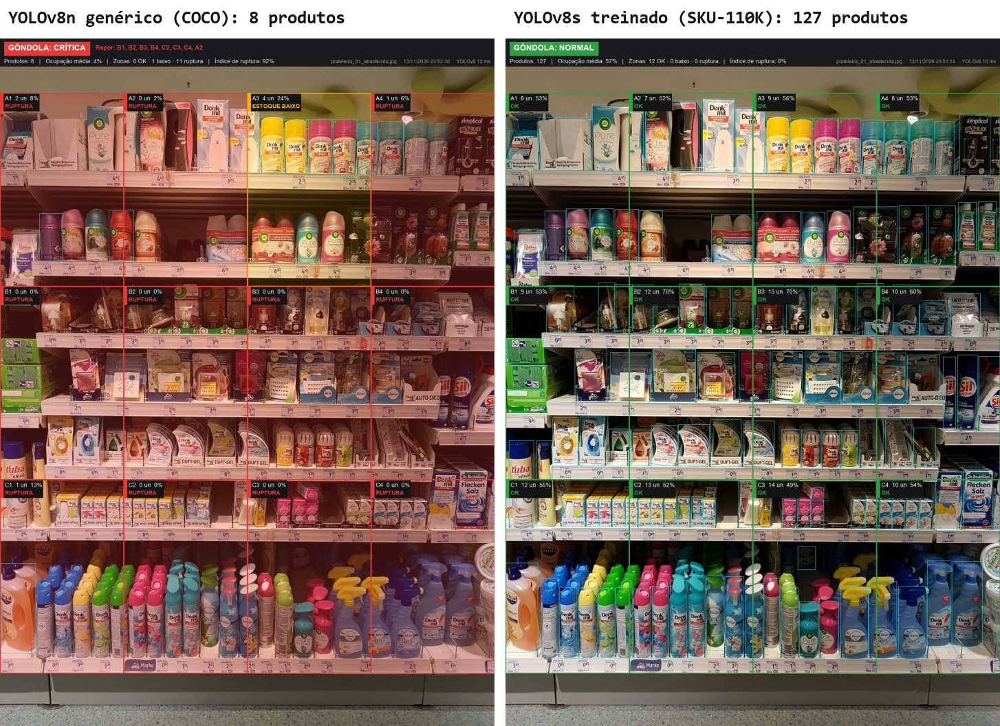

### 3.2 Dataset

Usei o **SKU-110K** (Goldman et al., CVPR 2019): fotos reais de gôndolas de supermercado com centenas de produtos anotados por imagem, em uma classe única (`produto`). O espelho em Parquet do Hugging Face (`benjamintli/sku110k`) foi convertido para o formato YOLO pelo script `treinamento/preparar_dataset.py`. As imagens foram reduzidas para 1024 px no maior lado, e as caixas `[x, y, w, h]` em pixels viraram `classe xc yc w h` normalizado.

Por limite de banda e tempo, usei um **subconjunto** do dataset (4 de 19 partes do treino):

| Conjunto | Imagens | Produtos anotados | Uso |
|---|---|---|---|
| Treino | 1.732 | 253.301 | ajuste dos pesos |
| Validação | 294 | 44.051 | escolha do melhor checkpoint |
| Teste | 420 | 61.461 | avaliação final (imagens nunca vistas) |

### 3.3 Configuração do treino

| Parâmetro | Valor |
|---|---|
| Modelo base | `yolov8s.pt` pré-treinado no COCO (transfer learning) |
| Épocas | 40 (scheduler cosseno; mosaic desligado nas 5 últimas) |
| Tamanho de entrada | 640 px |
| Batch | 8 |
| `max_det` | 1000 (uma prateleira tem centenas de produtos) |
| Hardware | NVIDIA RTX 4060 Laptop (8 GB), 2,1 h de treino |
| Script | `treinamento/treinar.py` (local) e `treinamento/treino_yolov8_colab.ipynb` (Colab, mesmos parâmetros) |

### 3.4 Resultados

Graças ao transfer learning, a primeira época já atingiu mAP50 = 0,777 na validação. A evolução ao longo das 40 épocas está em `modelo/graficos_treino/results.png`:

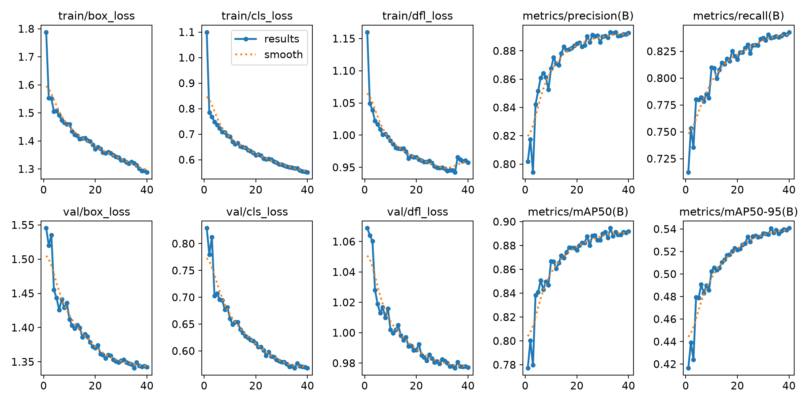

**Métricas no conjunto de TESTE** (420 imagens que o modelo nunca viu):

| Inferência | Precisão | Recall | mAP50 | mAP50-95 | Tempo/imagem (GPU) |
|---|---|---|---|---|---|
| 640 px | 0,892 | 0,830 | 0,899 | 0,545 | 5,1 ms |
| **800 px (padrão do main.py)** | **0,894** | **0,837** | **0,908** | **0,556** | 7,9 ms |

Leitura dos números: de cada 100 caixas que o modelo desenha, cerca de 89 são produtos de verdade (precisão), e ele encontra cerca de 84% dos produtos existentes (recall). Para a regra de negócio isso basta, porque a ocupação de uma zona depende da massa de produtos detectados e não de cada item individualmente.

---

## 4. Regra de negócio

### 4.1 Zonas da gôndola

A gôndola é dividida em zonas de três formas:

- **Grade automática:** `--linhas 3 --colunas 4` gera as zonas A1...C4 (A = prateleira de cima).
- **ROI** (`--roi x1,y1,x2,y2`): restringe a grade à área da gôndola. Com uma câmera fixa, isso é configurado uma única vez. Sem ROI, parede, teto e chão aparecem como "zonas vazias" e geram rupturas falsas (ver seção 6.3).
- **Planograma em JSON** (`--zonas config_zonas.json`): cada zona tem nome, retângulo, descrição do produto e, opcionalmente, a **capacidade** em frentes.

### 4.2 Métricas por zona

- **Quantidade de produtos:** caixas cujo centro está dentro da zona.
- **Taxa de ocupação** = área da zona coberta pela **união** das caixas detectadas / área da zona. A união é calculada com uma máscara binária, para que caixas sobrepostas não sejam contadas duas vezes.
- **Nível de abastecimento:** é a própria ocupação. Se a zona tiver `capacidade` no planograma, o nível passa a ser `quantidade / capacidade`.

### 4.3 Classificação e ação

| Status | Condição | Ação recomendada |
|---|---|---|
| OK | nível >= 40% | nenhuma |
| ESTOQUE BAIXO | 20% <= nível < 40% | programar reposição |
| RUPTURA | nível < 20% **ou** zona sem nenhum produto | repor **imediatamente** |

**Calibração dos limiares:** como bordas de prateleira, etiquetas de preço e vãos entre embalagens nunca ficam cobertos, nem uma zona cheia chega a 100% de ocupação. No conjunto de teste, a ocupação **mediana** de uma zona real foi de **54%**. Abaixo de 40% ficam cerca de 15% das zonas (prateleira visivelmente desfalcada) e abaixo de 20% cerca de 2% (vão evidente). Os limiares podem ser alterados com `--limiar-baixo` e `--limiar-ruptura` ou no JSON.

### 4.4 Indicadores da gôndola

- **Situação:** NORMAL (todas OK), ATENÇÃO (alguma zona com estoque baixo) ou CRÍTICA (alguma ruptura).
- **Índice de ruptura** = zonas em ruptura / total de zonas.
- **Ocupação média** e **total de produtos**.
- **Prioridade de reposição:** rupturas primeiro, depois estoque baixo, e dentro de cada grupo as zonas mais vazias à frente.

### 4.5 Persistência temporal (vídeo e webcam)

Num vídeo, um cliente parado na frente da prateleira esconde os produtos por alguns instantes. Para não alarmar à toa, cada zona tem uma pequena **máquina de estados**:

1. a cada quadro calcula-se o status instantâneo da zona;
2. se ele difere do status confirmado, vira um status *pendente* e o tempo começa a contar;
3. só depois de **2 segundos** contínuos (`--persistencia`) o novo status é **confirmado** e gera um evento;
4. se o status volta ao normal antes disso, a oscilação é **ignorada** e registrada no terminal como `(ignorado)`.

Eventos gerados: **ALERTA** (piora: OK para BAIXO, ou BAIXO para RUPTURA), **REPOSIÇÃO PARCIAL** (RUPTURA para BAIXO) e **NORMALIZADO** (volta para OK, reposição concluída).

### 4.6 Saídas

| Saída | Conteúdo |
|---|---|
| Terminal | tabela por zona, situação da gôndola, prioridade e alertas com ação recomendada |
| `*_resultado.jpg` / `*_resultado.mp4` | imagem/vídeo anotado: caixas dos produtos, zonas coloridas e painel de indicadores |
| `log_alertas.csv` | histórico de eventos (data/hora, fonte, zona, status anterior e novo, ocupação, ação) |
| `resumo_execucao.json` | indicadores e detalhe das zonas de cada fonte processada |

---

## 5. Como executar

```
pip install -r requirements.txt

python main.py --source amostras/prateleira_02_com_rupturas.jpg
python main.py --source amostras/prateleira_01_abastecida.jpg --roi 0,0.04,1,0.92
python main.py --source amostras/prateleira_04_planograma.jpg --zonas config_zonas.json
python main.py --source amostras/simulacao_ruptura.mp4
python main.py --source amostras/                    (pasta inteira; mesma grade/ROI p/ todas)
python main.py --source 0 --show                     (webcam, tecla q encerra)
```

| Parâmetro | Padrão | Descrição |
|---|---|---|
| `--source` | (obrigatório) | imagem, pasta, vídeo ou índice da webcam |
| `--weights` | `modelo/best.pt` | pesos do YOLOv8 |
| `--conf` / `--imgsz` | 0.35 / 800 | confiança mínima e tamanho de entrada |
| `--linhas` / `--colunas` | 3 / 4 | grade de zonas |
| `--roi` | gôndola inteira | área da gôndola `x1,y1,x2,y2` (0 a 1) |
| `--zonas` | - | planograma JSON (substitui a grade) |
| `--limiar-baixo` / `--limiar-ruptura` | 0.40 / 0.20 | limiares da regra |
| `--persistencia` | 2.0 s | tempo para confirmar alerta (vídeo/webcam) |
| `--saida` | `resultados/` | pasta das saídas |

---

## 6. Evidências de funcionamento

Todas as fotos são do **conjunto de teste** do SKU-110K, que o modelo não viu no treino. As evidências foram geradas pelo script `ferramentas/gerar_evidencias.py`, que executa o `main.py` em cada cenário e salva a saída do terminal (`evidencias/saida_*.txt`) e o print correspondente.

### 6.1 Gôndola abastecida: situação NORMAL

127 produtos detectados e 12 zonas OK (ocupação entre 49% e 70%). Nenhum alerta emitido.

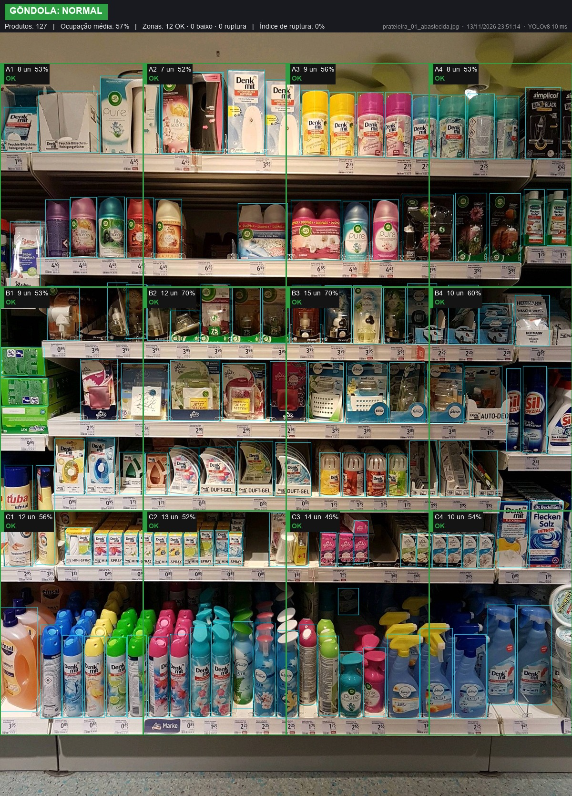

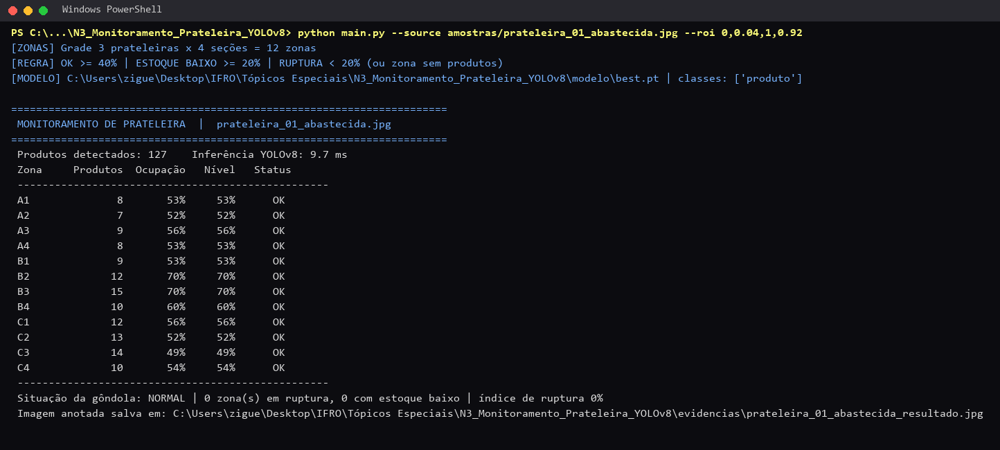

### 6.2 Gôndola com rupturas reais: situação CRÍTICA

As prateleiras de baixo (zonas C2 e C4) estão praticamente vazias e foram classificadas como **RUPTURA** (ocupação de 16% e 12%). Sete zonas com vãos visíveis ficaram como **ESTOQUE BAIXO**. O sistema gerou 9 alertas e a ordem de reposição **C4 > C2 > C1 > B1 > ...** (índice de ruptura de 17%).

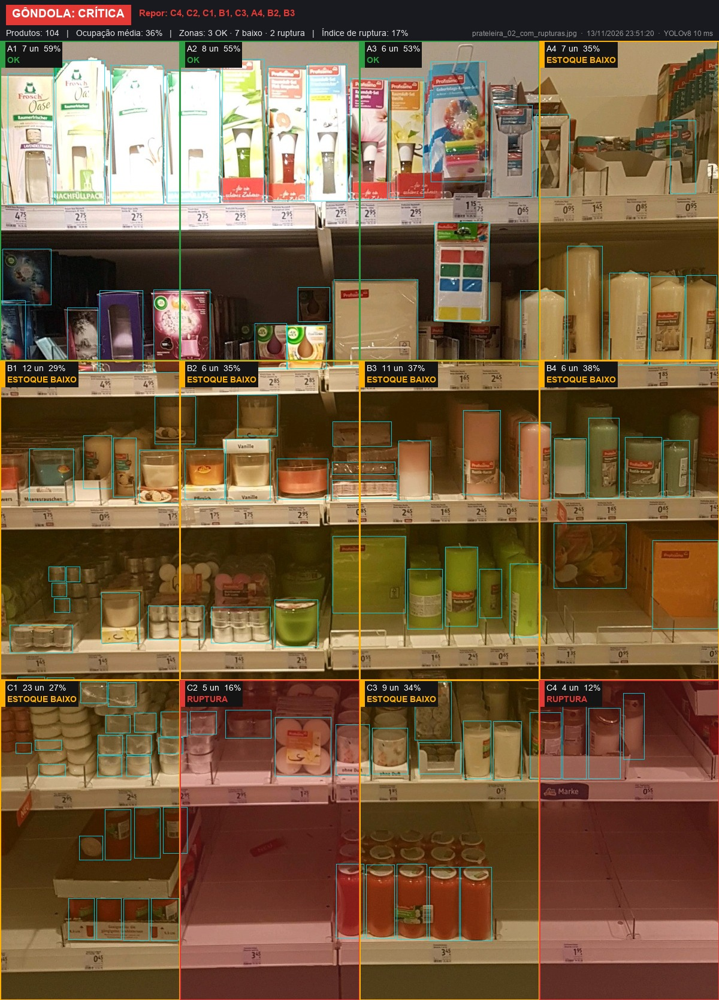

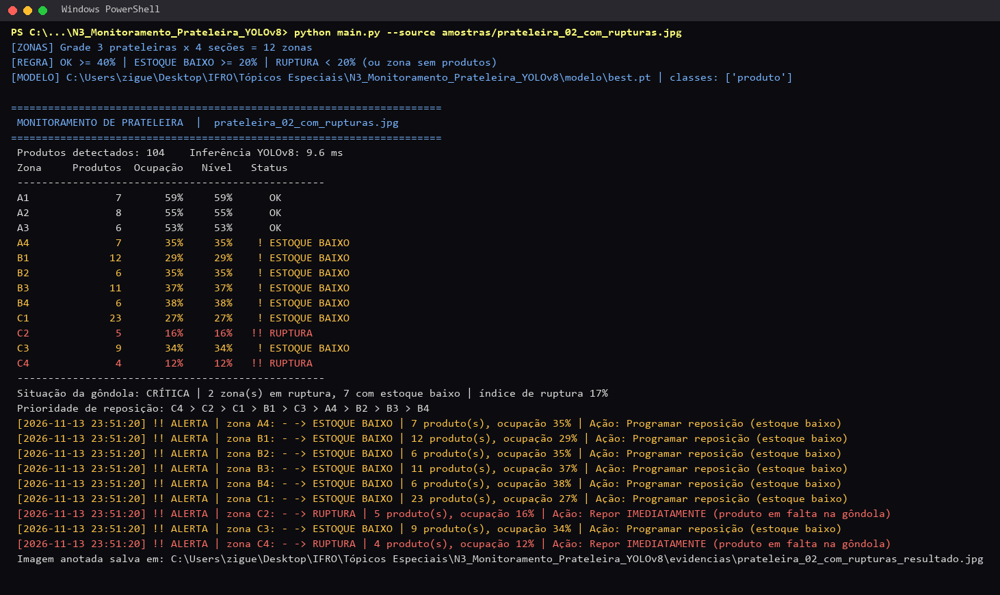

### 6.3 Importância do enquadramento (ROI)

Na foto, a gôndola ocupa só parte da imagem. **Sem ROI**, parede, teto e chão viraram 8 "rupturas" falsas. **Com ROI** (`--roi 0,0.16,0.83,0.78`), só a prateleira de cima à esquerda, que de fato está rala, foi sinalizada (A1, ESTOQUE BAIXO):

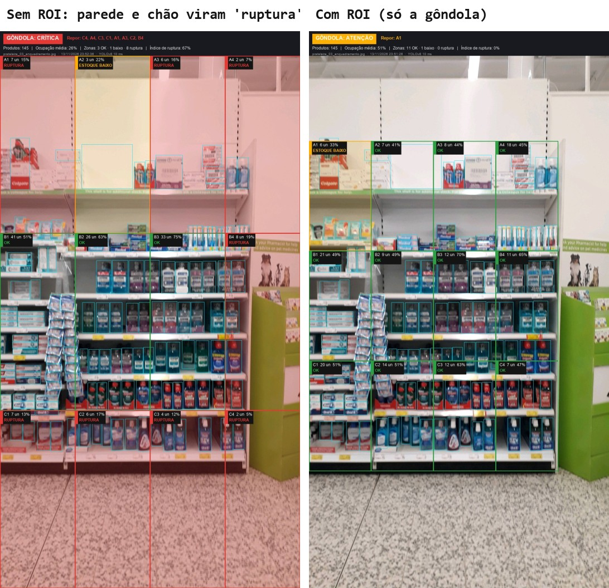

### 6.4 Planograma em JSON

Aqui o arquivo `config_zonas.json` descreve as 7 prateleiras reais da gôndola (14 zonas, com o nome do produto em cada uma). As zonas P2 usam **capacidade** de 10 frentes, então o nível é calculado por contagem (P2-D: 8/10 = 80%). O alerta saiu para os **lenços umedecidos (P7-E)**, onde o lado esquerdo está visivelmente vazio.

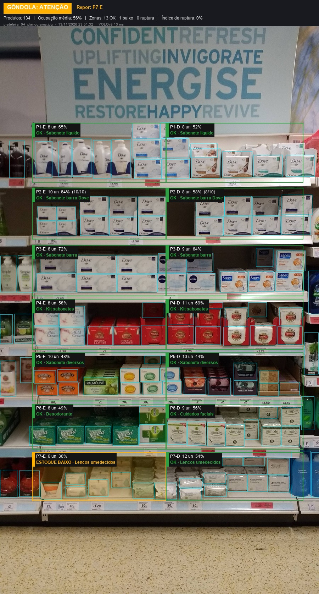

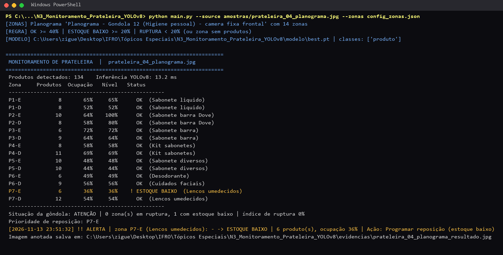

### 6.5 Vídeo: regra temporal (cliente passando, vendas e reposição)

Para testar a persistência, o script `ferramentas/gerar_video_simulacao.py` criou um vídeo de 23 s **a partir da foto real da seção 6.1**. Ele simula:

1. um cliente passando na frente da gôndola (silhueta, 1,2 s);
2. os 12 produtos da zona B2 sendo retirados um a um (vendas), apagados com *inpainting*;
3. o repositor reabastecendo a zona.

*Obs.: é uma simulação construída sobre uma foto real, porque não havia acesso a uma câmera em supermercado. O `main.py` processa vídeos reais e webcam da mesma forma.*

| Tempo | O que aconteceu | Resposta do sistema |
|---|---|---|
| 3,2 a 4,1 s | cliente passa na frente | 6 oscilações **ignoradas** (duraram de 0,1 a 0,3 s < 2 s): **nenhum alarme falso** |
| 11,1 s | B2 com 5 produtos (28%) | **ALERTA** OK para ESTOQUE BAIXO: programar reposição |
| 14,3 s | B2 com 1 produto (9%) | **ALERTA** ESTOQUE BAIXO para RUPTURA: repor imediatamente |
| 19,1 s | reabastecimento em andamento | passagem de 0,3 s por ESTOQUE BAIXO **ignorada** |
| 21,1 s | B2 reabastecida (12 produtos, 68%) | **NORMALIZADO**: reposição concluída |

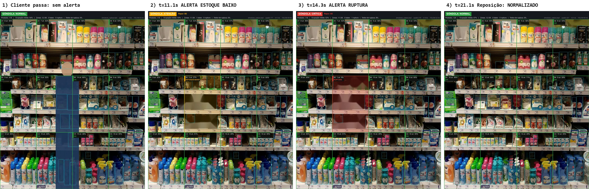

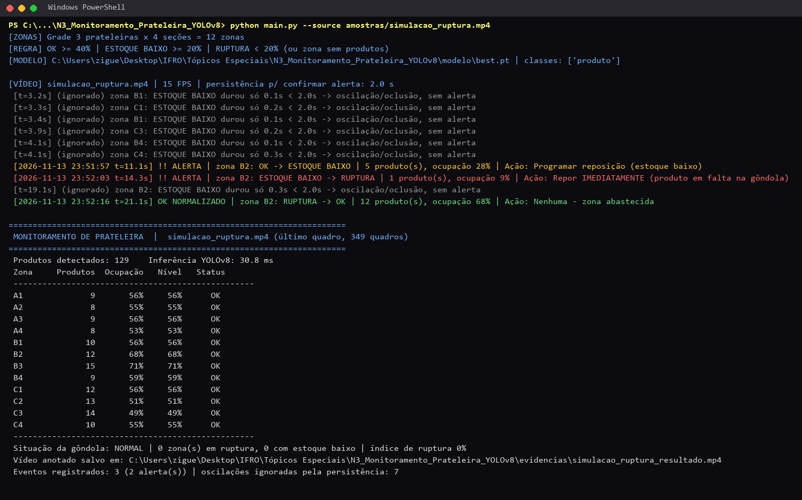

Vídeo anotado completo: `evidencias/simulacao_ruptura_resultado.mp4`.

### 6.6 Log de alertas (`evidencias/log_alertas.csv`, trecho)

| data_hora | fonte | zona | evento | anterior | status | produtos | ocupação |
|---|---|---|---|---|---|---|---|
| 23:51:20 | prateleira_02_com_rupturas.jpg | C2 | ALERTA | - | RUPTURA | 5 | 15,9% |
| 23:51:20 | prateleira_02_com_rupturas.jpg | C4 | ALERTA | - | RUPTURA | 4 | 12,4% |
| 23:51:32 | prateleira_04_planograma.jpg | P7-E | ALERTA | - | ESTOQUE BAIXO | 6 | 35,8% |
| 23:51:57 | simulacao_ruptura.mp4 | B2 | ALERTA | OK | ESTOQUE BAIXO | 5 | 27,6% |
| 23:52:03 | simulacao_ruptura.mp4 | B2 | ALERTA | ESTOQUE BAIXO | RUPTURA | 1 | 9,4% |
| 23:52:16 | simulacao_ruptura.mp4 | B2 | NORMALIZADO | RUPTURA | OK | 12 | 68,4% |

---

## 7. Explicação do código (`main.py`)

| Parte | Função / classe | O que faz |
|---|---|---|
| Estruturas | `Zona`, `Regra`, `ResultadoZona`, `Evento` | dataclasses com a zona (retângulo normalizado, capacidade, descrição), os limiares, o resultado de cada zona e cada evento do log |
| Zonas | `criar_grade()`, `carregar_planograma()` | geram as zonas por grade + ROI ou leem o planograma JSON |
| Detecção | `carregar_modelo()`, `detectar()` | carregam o `best.pt` (com o `yolov8n.pt` do COCO como contingência) e executam `model.predict()` com `max_det=1000`, devolvendo as caixas `xyxy` |
| **Regra** | `avaliar_prateleira()` | monta a máscara com a união das caixas e calcula, por zona, a quantidade, a ocupação e o nível |
| **Regra** | `classificar()` | aplica os limiares: OK / ESTOQUE BAIXO / RUPTURA |
| **Regra** | `resumir()` | situação da gôndola, índice de ruptura, ocupação média e prioridade de reposição |
| **Regra** | `GerenciadorAlertas` | máquina de estados com persistência: confirma ou ignora mudanças, gera os eventos ALERTA/NORMALIZADO e grava o CSV |
| Visualização | `desenhar()` | desenha as caixas, as zonas coloridas por status e o painel de indicadores (Pillow, para ter acentuação) |
| Fontes | `processar_imagem()`, `processar_video()` | fluxo para imagem estática e para vídeo/webcam (quadro a quadro, com gravação do vídeo anotado) |
| CLI | `argumentos()`, `main()` | parâmetros de linha de comando, prioridade CLI > JSON > padrão, e gravação do resumo JSON |

Núcleo da regra de negócio (trecho simplificado):

```python
def classificar(nivel, qtd, regra):
    if qtd == 0 or nivel < regra.limiar_ruptura:
        return RUPTURA
    if nivel < regra.limiar_baixo:
        return BAIXO
    return OK

# em avaliar_prateleira(): ocupação = fração da zona coberta pela união das caixas
for x1, y1, x2, y2 in caixas:
    mascara[y1:y2, x1:x2] = 1
ocupacao = mascara[zona].mean()
nivel = qtd / zona.capacidade if zona.capacidade else ocupacao
```

Scripts auxiliares:

- `treinamento/preparar_dataset.py`: baixa os Parquet do SKU-110K e converte para o formato YOLO;
- `treinamento/treinar.py`: treina, avalia no teste e copia o `best.pt` e os gráficos para `modelo/`;
- `ferramentas/gerar_video_simulacao.py`: gera o vídeo de teste da regra temporal;
- `ferramentas/gerar_evidencias.py`: reproduz todas as evidências deste relatório;
- `ferramentas/print_terminal.py`, `video_h264.py` e `gerar_pdf.py`: utilitários do relatório.

---

## 8. Limitações e melhorias futuras

- **Classe única:** o modelo sabe que há um produto, mas não qual SKU está faltando. O próximo passo seria treinar classes por produto ou adicionar um classificador de embalagens sobre cada caixa detectada.
- **Dependência do enquadramento:** a regra pressupõe uma câmera fixa e frontal, com ROI ou planograma configurado. Fotos em perspectiva acentuada distorcem a ocupação.
- **Profundidade:** um produto lá no fundo da prateleira ainda é detectado. A câmera não percebe que a frente está vazia (falta de *facing*).
- **Treino parcial:** foram usadas 1.732 das 8.219 imagens de treino do SKU-110K. O dataset completo e mais épocas devem aumentar o recall.
- **Integração:** enviar os alertas por Telegram/WhatsApp ou MQTT, montar um painel web com o histórico do CSV e cruzar com o ERP para separar "ruptura de gôndola" (há estoque no depósito) de "ruptura de estoque" (precisa comprar).

---

## 9. Estrutura da entrega

```
N3_Monitoramento_Prateleira_YOLOv8/
  main.py                    script principal (YOLOv8 + regra de negócio)
  config_zonas.json          exemplo de planograma
  requirements.txt
  README.md                  este relatório
  Relatorio_Tecnico_N3.pdf   este relatório em PDF
  modelo/
    best.pt                  pesos treinados (YOLOv8s, SKU-110K)
    graficos_treino/         curvas, métricas de teste, amostras de validação
  treinamento/
    treino_yolov8_colab.ipynb   notebook do Google Colab
    preparar_dataset.py, treinar.py
  amostras/                  imagens de teste e vídeo de simulação
  evidencias/                saídas do main.py (imagens, vídeo, prints, CSV, JSON)
  ferramentas/               scripts auxiliares (evidências, vídeo, PDF)
```

---

## 10. Referências

- GOLDMAN, E. et al. *Precise Detection in Densely Packed Scenes*. CVPR, 2019. Dataset SKU-110K: https://github.com/eg4000/SKU110K_CVPR19
- ULTRALYTICS. *YOLOv8 Documentation*. https://docs.ultralytics.com
- GRUEN, T. W.; CORSTEN, D. S.; BHARADWAJ, S. *Retail Out-of-Stocks: A Worldwide Examination of Extent, Causes and Consumer Responses*. Grocery Manufacturers of America, 2002.
- Espelho Parquet do SKU-110K: https://huggingface.co/datasets/benjamintli/sku110k
